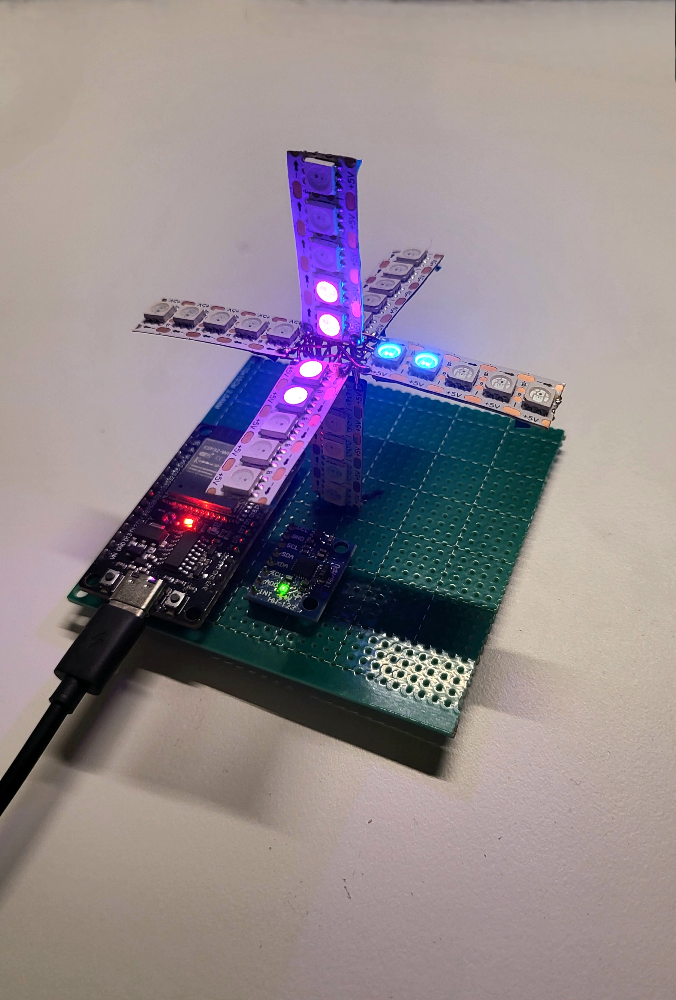

# Acceleration Cube (ESP-IDF) 🚀

Small ESP-IDF project for an ESP32 + MPU6050 + WS2812 LED strip.
It shows real linear acceleration on X, Y, and Z in different colors. 🎨



## Hardware 🔧

- ESP32
- MPU6050 (I2C address 0x68)
- 30x WS2812 / NeoPixel LEDs

## Wiring 📌

- LED data -> GPIO17
- MPU6050 SDA -> GPIO21
- MPU6050 SCL -> GPIO22
- Shared GND

## Build & Flash ⚡

```sh
idf.py set-target esp32
idf.py build
idf.py -p COM4 flash monitor
```

Replace COM4 with your serial port.

## Notes 🧠

- Sensor rotation and axis inversion are configurable in main/acceleration_cube.c
- Gravity is filtered out, so LEDs react to motion, not static tilt
